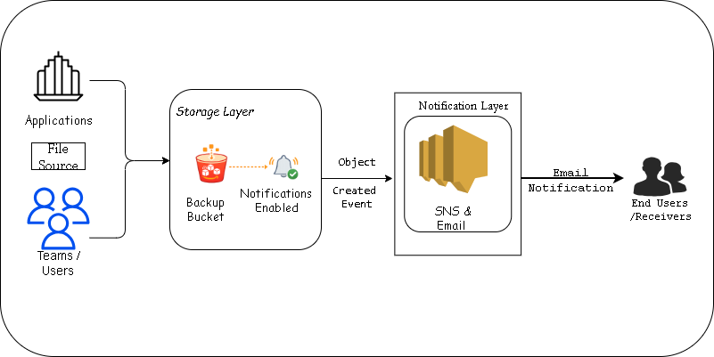

# File Backup Notifications with Amazon S3 and SNS


Automating backup event alerts with S3 and SNS. Receiving **email** in real-time when a file is landed in your bucket. Event-based monitoring. Testing done with CLI. No need of servers, no scripts, no manual checking.

---

## Contents

1. [Overview](#-overview)
2. [Architecture](#-architecture)
3. [Prerequisites](#-prerequisites)
4. [Environment Preparation](#-environment-preparation)
5. [Deployment Steps](#-deployment-steps)
6. [Validation & Testing](#-validation--testing)
7. [Cleanup](#-cleanup)
8. [Key Outcomes](#-key-Outcomes)

---

# #-overview

### The Problem

The issue is that organizations wanted to retain operational reliability while guaranteeing commitment to data privacy on real-time file transfer and backup processes. Without automated alerts, failed or missing backups are often discovered hours or days later, which risks data loss. Maintaining consistent backup verification procedures is challenging since manual S3 bucket monitoring is time-consuming and prone to human mistake.

### The Solution

A programmed notification system using ** Amazon S3 event notifications** integrated/combined with Amazon SNS **(Simple Notification Service)** to send instant email alerts whenever files are uploaded to your backup bucket. This cloud-based solution ensures instant awareness of successful file transfers and backup completions by providing real-time monitoring of backup activities without the need for manual inspection or custom monitoring scripts.


| | |
|---|---|
| **Services used** | Amazon S3, Amazon SNS |
| **Where it runs** | AWS CloudShell |
| **Architecture** | Serverless |
| **Tags** | `Automated Alerts` `Backup` `Real-Time Monitoring` `S3 Event Notifications` `SNS Email Alerts` |

---

# #-Architecture



* Amazon S3: Stores backup files in a bucket.
* S3 Event Notification: Triggers when a new object is created.
* Amazon SNS: Sends notifications through email.
* End Users: Receive email alerts about new backups.
* Purpose: Automates backup notifications and keeps users informed.

**How it flows:**

1. A file is uploaded to the **S3 bucket**.
2. S3 fires an `ObjectCreated` event.
3. The event is published to an **SNS topic**.
4. SNS delivers an **email** to the subscribed address.

---

# #-Prerequisites

- An AWS account with permission to use S3, SNS and Secrets Manager.
- Access to **AWS CloudShell** (open it from the console toolbar).
- An email address one can check into.

---

# #-Environment Preparation

Run these in CloudShell. They store your settings in variables so later commands can reuse them.

```bash
# Region you are working in
REGION=$(aws configure get region)

# Your 12-digit AWS account ID
ACCOUNT_ID=$(aws sts get-caller-identity --query Account --output text)

# Random 8-character suffix so resource names are globally unique
# (lowercased because S3 bucket names must be lowercase)
SUFFIX=$(aws secretsmanager get-random-password \
  --exclude-punctuation \
  --password-length 8 \
  --require-each-included-type \
  --output text \
  --query RandomPassword | tr 'A-Z' 'a-z')

# Resource names
BUCKET_NAME=backup-notifications-$SUFFIX
SNS_TOPIC_NAME=backup-alerts-$SUFFIX

# Email that will receive the alerts
EMAIL_ADDRESS="your_email@example.com"

# Check the values
echo $REGION $ACCOUNT_ID $BUCKET_NAME $SNS_TOPIC_NAME $EMAIL_ADDRESS
```

<details>
<summary>💡 What do these commands do?</summary>

| Command | Purpose |
|---|---|
| `aws configure get region` | Shows the region you are working in |
| `aws sts get-caller-identity` | Returns basic account details; `--query Account` keeps just the account number |
| `aws secretsmanager get-random-password` | Generates a random string used as a unique name suffix. Without `--query` you would get JSON |

</details>

---

# #-Deployment Steps

### Step 1: Create the SNS topic

```bash
SNS_TOPIC_ARN=$(aws sns create-topic \
  --name $SNS_TOPIC_NAME \
  --query 'TopicArn' \
  --output text)

echo $SNS_TOPIC_ARN
```

SNS Topic 

### Step 2: Subscribe your email to the topic

```bash
aws sns subscribe \
  --topic-arn $SNS_TOPIC_ARN \
  --protocol email \
  --notification-endpoint $EMAIL_ADDRESS
```

> ⚠️ **Important:** AWS sends a confirmation email. Open it and click **Confirm subscription**, otherwise you will not receive alerts.

Subscribing, E-Mail 

### Step 3: Create the S3 bucket (versioning + encryption)

```bash
# Create the bucket
aws s3 mb s3://$BUCKET_NAME --region $REGION

# Keep every version of each file
aws s3api put-bucket-versioning \
  --bucket $BUCKET_NAME \
  --versioning-configuration Status=Enabled

# Encrypt files at rest
aws s3api put-bucket-encryption \
  --bucket $BUCKET_NAME \
  --server-side-encryption-configuration '{"Rules":[{"ApplyServerSideEncryptionByDefault":{"SSEAlgorithm":"AES256"}}]}'
```

S3 Bucketing 

### Step 4: Let S3 publish to the SNS topic

This policy allows **only your bucket, in your account**, to publish to the topic.

```bash
cat > sns-policy.json << EOF
{
  "Version": "2012-10-17",
  "Statement": [
    {
      "Sid": "AllowS3ToPublish",
      "Effect": "Allow",
      "Principal": { "Service": "s3.amazonaws.com" },
      "Action": "SNS:Publish",
      "Resource": "${SNS_TOPIC_ARN}",
      "Condition": {
        "StringEquals": { "aws:SourceAccount": "${ACCOUNT_ID}" },
        "StringLike":   { "aws:SourceArn": "arn:aws:s3:::${BUCKET_NAME}" }
      }
    }
  ]
}
EOF

aws sns set-topic-attributes \
  --topic-arn $SNS_TOPIC_ARN \
  --attribute-name Policy \
  --attribute-value file://sns-policy.json
```

Event Notification 

### Step 5: Turn on S3 event notifications

```bash
cat > notification-config.json << EOF
{
  "TopicConfigurations": [
    {
      "Id": "BackupNotification",
      "TopicArn": "${SNS_TOPIC_ARN}",
      "Events": ["s3:ObjectCreated:*"]
    }
  ]
}
EOF

aws s3api put-bucket-notification-configuration \
  --bucket $BUCKET_NAME \
  --notification-configuration file://notification-config.json
```

S3 Event Notification Config 
S3 Event Notification Config, continued


### Step 6: Create test files

```bash
echo "Backup test file created at $(date)"       > test-backup-1.txt
echo "Database backup completed at $(date)"      > test-backup-2.txt
echo "Application logs archived at $(date)"      > test-backup-3.txt
echo "Validation test created at $(date)"        > validation-test.txt
```

---

# #-Validation & Testing

### 1. Upload files to trigger notifications

```bash
aws s3 cp test-backup-1.txt s3://$BUCKET_NAME/
aws s3 cp test-backup-2.txt s3://$BUCKET_NAME/backups/
aws s3 cp test-backup-3.txt s3://$BUCKET_NAME/logs/
```

**Expected result:** three emails within a few minutes, one per uploaded file.

### 2. Verify objects and metrics

```bash
# List everything in the bucket
aws s3 ls s3://$BUCKET_NAME/ --recursive

# Count messages SNS published in the last 10 minutes
aws cloudwatch get-metric-statistics \
  --namespace AWS/SNS \
  --metric-name NumberOfMessagesPublished \
  --dimensions Name=TopicName,Value=$SNS_TOPIC_NAME \
  --start-time $(date -u -d '10 minutes ago' '+%Y-%m-%dT%H:%M:%S') \
  --end-time $(date -u '+%Y-%m-%dT%H:%M:%S') \
  --period 300 \
  --statistics Sum
```

**Expected result:** the objects are listed, and CloudWatch shows published messages.

### 3. Check the email content

```bash
aws s3 cp validation-test.txt s3://$BUCKET_NAME/validation/
```

The new email should contain:

| Field | Expected value |
|---|---|
| Bucket name | your `BUCKET_NAME` |
| Object key | `validation/validation-test.txt` |
| Event type | `ObjectCreated:Put` |

---

# #-Cleanup

Delete everything when you are done so you are not left with stray resources.

<details>
<summary><b>Click to expand cleanup commands</b></summary>

**1. Empty the bucket** (versioning is on, so remove old versions and delete markers too)

```bash
aws s3 rm s3://$BUCKET_NAME --recursive

for KEY in Versions DeleteMarkers; do
  aws s3api delete-objects --bucket "$BUCKET_NAME" \
    --delete "$(aws s3api list-object-versions --bucket "$BUCKET_NAME" \
      --query "{Objects: $KEY[].{Key:Key,VersionId:VersionId}}" --output json)" \
    2>/dev/null
done
```

**2. Delete the bucket and its notification config**

```bash
aws s3api put-bucket-notification-configuration \
  --bucket $BUCKET_NAME \
  --notification-configuration '{}'

aws s3 rb s3://$BUCKET_NAME
```

**3. Delete the SNS topic and subscription**

```bash
aws sns delete-topic --topic-arn $SNS_TOPIC_ARN
```

**4. Remove local files and variables**

```bash
rm -f test-backup-*.txt validation-test.txt
rm -f sns-policy.json notification-config.json
unset BUCKET_NAME SNS_TOPIC_NAME EMAIL_ADDRESS SNS_TOPIC_ARN SUFFIX ACCOUNT_ID REGION
```

</details>

---

# #-Key Outcomes

- S3 event notifications plus SNS give you **real-time backup alerts with no code to maintain**.
- A **topic policy** with account and bucket conditions keeps publishing locked down to your bucket.
- **Versioning and encryption** protect the backups themselves.
- Always **clean up** test resources to avoid unnecessary cost.


